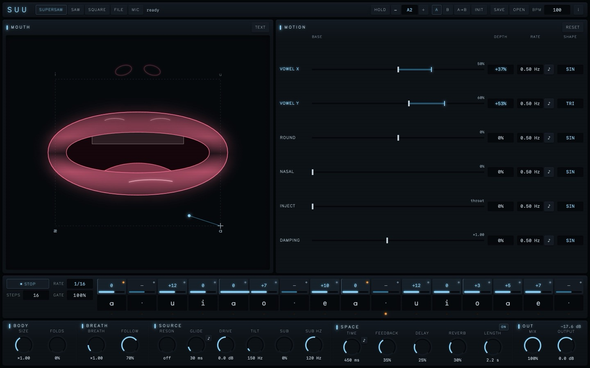

# Suu

Suu is a talking filter: any sound through a simulated human vocal tract.
Shape the mouth on a vowel pad, set it moving, type words for it to sing, or
sequence vowels and notes. A browser app now; VST3 and CLAP plug-ins are in
progress.

See it live: [**https://janne-s.github.io/Suu/**](https://janne-s.github.io/Suu/)



## How it works

The sound enters the airway as airflow and leaves through the lips, so the
mouth's shape filters it as it would a voice. The airway, articulators and
vocal folds are a physical simulation. Tilt, the sub layer, the resonator,
glide and Space are production extras. Ranges go past human anatomy on
purpose.

## Mouth

- **Vowel pad** — Drag the mouth: left to right front to back, top to bottom
  close to open. The edge beyond the corner vowels extrapolates.
- **Horn** — The tract from the side, glottis to lips, as it sounds now.
  Drag to draw your own, build it from a **Wave** (cycles and depth), or take
  one period of the sound with the camera; ↺ restores the original. **Morph** blends the horn in, **Shift** slides it
  along the tract (a wave wraps, so it can travel through), **Open** widens it.
- **Text** — Type words. **Gate** sings a syllable per note, **One-shot** a
  word per note, **Loop** syllables at its own rate or ♪, starting over with the
  sequence (**Seq**) or running free (**Free**).
- **Motion** — Vowel X/Y, Round, Nasal, Inject, Damping, Morph, Shift and
  Open, each with Depth, Rate or ♪, and a shape (sine, triangle, saw, square,
  random, envelope).

## Sequencer

Sixteen steps, each with a note, vowel, accent ◆ and length. Drag a step up or
down for its note, click to turn it on, Shift-click to tie, click the vowel
to change it. **Gate** scales every step's length alike.

## Sound

- **Source** — Supersaw, saw, square, an audio file or the mic. Keys, Hold
  and the sequencer gate every source.
- **Body** — Size of the mouth (0.4–4×) and Folds, the model's own vocal
  folds at the played note.
- **Breath** — Lung pressure for the consonants, and how far it follows the
  source.
- **Reson** — A resonator tuned to the played note, so a file or mic plays in
  pitch. Off by default.
- **Glide**, **Drive**, **Tilt**, **Sub** — Pitch and vowel glide (♪ syncs it), level
  into the mouth, source brightness, and the dry low end.
- **Space** — Delay and reverb, web only. Off is what the plug-in does.

Keys **A W S E D F T G Y H U J K** play, **Z X** change octave, **Space**
plays the sequencer, **Esc** releases all notes. Settings are kept in the
browser with A/B and Init. Save and Open write and read preset files.

## Run

Rust with the `wasm32-unknown-unknown` target, and Bun.

```sh
bun install
bun run suu        # http://127.0.0.1:5318/
```

## Tests

```sh
bun run test       # cargo test --workspace and bun tests
bun tools/suu-e2e.ts   # headless Chrome, with bun run suu running
```

## Limits

English text only. Mono. Tested in Chrome and Safari. No plug-in yet.

## Credits

Built on [CHIMERA](https://github.com/jamesondh/chimera-vocal-synth) by Jameson
Hodge, not affiliated. Suu adds the driven airway and the effect core
(`crates/suu`, `crates/suu-wasm`, `web-suu/`). CHIMERA's own voice app and
docs remain in `src/` and `docs/`. See [AGENTS.md](AGENTS.md) for the engine's
rules.

## License

Suu by Janne Särkelä; CHIMERA by Jameson Hodge. [MIT](LICENSE). The CMU
Pronouncing Dictionary and the AVHershey fonts keep their own licenses
([public/data/](public/data/), [public/fonts/](public/fonts/)).
