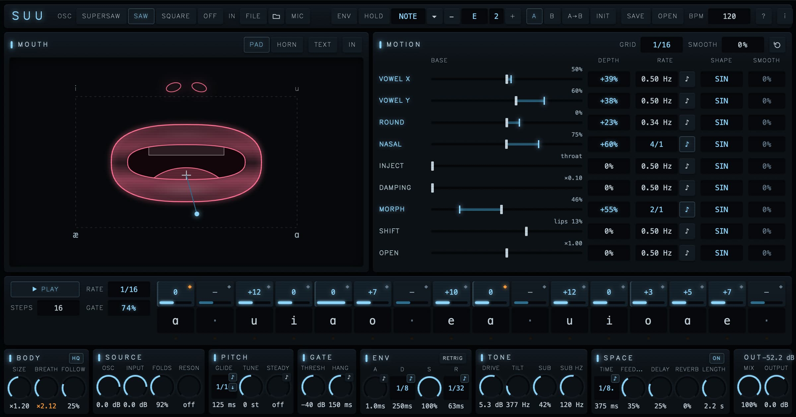

# Suu

Suu is a talking filter: any sound through a simulated human vocal tract.
Shape the mouth on a vowel pad, set it moving, type words for it to sing, or
sequence vowels and notes. In the browser, and as a VST3 and CLAP plug-in.

See it live: [**https://janne-s.github.io/Suu/**](https://janne-s.github.io/Suu/) ·
Plug-in: [**Releases**](https://github.com/janne-s/Suu/releases)



## How it works

The sound enters the airway as airflow and leaves through the lips, so the
mouth's shape filters it as it would a voice. The airway, articulators and
vocal folds are a physical simulation. Tilt, the sub layer, the resonator,
glide and Space are production extras. Ranges go past human anatomy on
purpose.

## Mouth

- **Vowel pad**: drag the point to choose the vowel. The pad's corners are
  i, u, æ and ɑ.
  - Left to right: from front vowels (i, æ) to back vowels (u, ɑ).
  - Top to bottom: from close vowels (i, u) to open vowels (æ, ɑ).
  - The border outside the corners goes past those vowels, further than a
    human mouth can.
- **Horn**: the tract from the side, glottis to lips, as it sounds now.
  - Drag to draw your own, build it from a **Wave** (cycles and depth), or
    take one period of the sound with the camera. ↺ restores the original.
  - **Morph** blends the horn in.
  - **Shift** slides it along the tract. A wave wraps, so it can travel
    through.
  - **Open** widens it.
- **Text**: type words, and choose how they are said.
  - **Step**: each note says the next part, or the text's own **Clock** does
    (a rate, or ♪ for a note value).
  - **Unit**: a syllable or a word at a time.
  - **Say**: **Hold** keeps the vowel while the note lasts, **Shot** says the
    part through.
  - **Len**: on the Clock, how much of each tick Hold keeps the vowel. At
    100% the parts join.
  - **Start**: **Free**, or **Seq** to start over with the sequence.
  - **Repeat**: **Loop**, or **1×** once a pass.
  - **Speed**: how fast it is spoken, from ×0.25 to ×4.
  - **Gate**: how much of each part is heard. **Fit**: the text bounds the
    note, so each note lasts only as long as its syllable or word; on the
    Clock the gaps between parts fall silent.
  - **Round**: fades each part in and out like a grain. At 0% the sound
    stays on.
- **Motion**: moves Vowel X/Y, Round, Nasal, Inject, Damping, Morph, Shift
  and Open. Each has:
  - **Depth**, and **Rate** or ♪.
  - A shape: sine, triangle, saw, square, random, envelope or ADSR.
  - **Smooth**, from sharp jumps to gliding ones.

## Sequencer

Sixteen steps, each with a note, vowel, accent ◆ and length. Drag a step up or
down for its note, click to turn it on, Shift-click to tie, click the vowel
to change it. **Gate** scales every step's length alike.

## Sound

- **Osc** and **In** — The oscillator (supersaw, saw, square or off) and an
  input (a file or the mic; in the plug-in, the track) sound together, each at
  its level. Keys, Hold and the sequencer gate both.
- **Body** — Size of the mouth (0.4–4×), Breath (lung pressure for the
  consonants and folds) and Follow (how far it follows the sound). The
  quality button steps through **HQ**, **Lean** (two to three times lighter)
  and **Lo** (lighter still; fast mouth moves are a little smoother).
- **Air** — The airway's turbulence, each source on its own: Aspir (breath at
  the folds, h), Fric (the narrowest point: f, sh) and Sibil (the teeth: s),
  0–1000%. Whistle tames the ringing of a mouth closed at both the tongue and
  the lips. Move is the sound of the mouth changing shape, the air its moving
  walls push: 0% silences it, up to 800%.
- **Source** — Osc and Input levels, Folds (the model's own vocal folds at the
  played note; 100% is about as loud as Osc at 0 dB), Reson (a resonator tuned
  to the played note, so an input plays in pitch) and Glide (pitch and vowel;
  ♪ syncs it; ↕ ↑ ↓ both ways, only up or only down). With the pitch from
  the input, Steady takes a new note only once it has lasted, so a slide
  between notes is not heard as the notes on the way.
- **Tone** — Drive into the mouth, Tilt (source brightness), and Sub (the dry
  low end).
- **Stereo** — A second mouth on the right, a little larger (Spread) and with
  its vowel moved (Vowel); Width sets how far apart they sound. Phase runs
  its Motion ahead in the cycle, Canon has it say the text that many parts
  behind (up to the text's own count), and Mirror turns its horn round. It
  doubles the CPU, so it is off until switched on.
- **Space** — Delay and reverb, web only. Off is what the plug-in does.

Keys **A W S E D F T G Y H U J K** play, **Z X** change octave, **Space**
plays the sequencer, **Esc** releases all notes. Settings are kept in the
browser. The **Preset** menu has A/B to compare, Init, and Save and Open for
preset files.

## Install the plug-in

macOS 11 or later, Apple silicon. Two plug-ins: **Suu** (an effect: the
track through the mouth, MIDI from another track) and **Suu Synth** (an
instrument: the oscillator through the mouth, a sidechain as input).

In the plug-in the **MPE** menu chooses what a key's pressure and slide move
(any Motion target, Breath or Level, with a depth) and sets the pitch bend
range.

Unzip the release and copy the `.vst3` files to `~/Library/Audio/Plug-Ins/VST3/`
(and the `.clap` files to `~/Library/Audio/Plug-Ins/CLAP/`). The build is not
notarized, so clear the quarantine once (the second line for CLAP):

```sh
xattr -dr com.apple.quarantine ~/Library/Audio/Plug-Ins/VST3/Suu*.vst3
xattr -dr com.apple.quarantine ~/Library/Audio/Plug-Ins/CLAP/Suu*.clap
```

## Run

Rust with the `wasm32-unknown-unknown` target, and Bun (only for the local
server and the browser checks; the page itself has no build step).

```sh
bun install
bun run web            # http://127.0.0.1:5318/
bun run build:plugin   # VST3 and CLAP in plugin/target/bundled/
```

## Tests

```sh
bun run test       # the engine, the core and the plug-in (cargo test)
bun run e2e        # headless Chrome, with bun run web running
```

## Layout

| Folder | What |
|---|---|
| `crates/chimera/` | CHIMERA's vocal-tract engine |
| `crates/suu/` | Suu's core: the driven airway, oscillator, Motion, text, sequencer |
| `crates/suu-wasm/` | the core's interface for the web page |
| `plugin/` | the VST3/CLAP effect and instrument |
| `web/` | the page, which is also the plug-in's window |
| `data/` | pronouncing dictionary and fonts, with their licenses |
| `tools/` | web build, local server, browser checks |

## Limits

- English text only.
- One note at a time.
- A stereo input is mixed to mono. The output is stereo only with **Stereo**
  on.
- The page is tested in Chrome and Safari.
- The plug-in is VST3 and CLAP for macOS on Apple silicon, tested in Ableton
  Live.

## Credits

Built on [CHIMERA](https://github.com/jamesondh/chimera-vocal-synth) by Jameson
Hodge, not affiliated. Suu keeps CHIMERA's engine (`crates/chimera/`) and its
history, and adds the driven airway, the effect core, the web page and the
plug-in. CHIMERA's own voice app is not part of Suu; it remains in the original
repository. See [AGENTS.md](AGENTS.md) for the engine's rules.

## License

Copyright © 2026 Janne Särkelä. Suu is free software under the
[GNU General Public License v3.0 or later](LICENSE): you may use, change and
share it, also commercially, as long as what you share stays under the same
license with its source.

CHIMERA's engine (`crates/chimera/`) is © 2026 Jameson Hodge under the
[MIT License](crates/chimera/LICENSE). The CMU Pronouncing Dictionary and the
AVHershey fonts keep their own licenses ([data/](data/), [data/fonts/](data/fonts/)).

## Support Suu

Support development through [GitHub Sponsors](https://github.com/sponsors/janne-s)
or [Ko-fi](https://ko-fi.com/jannesarkela). See
[Sanara Creations](https://www.sanaracreations.fi/) for related work.
